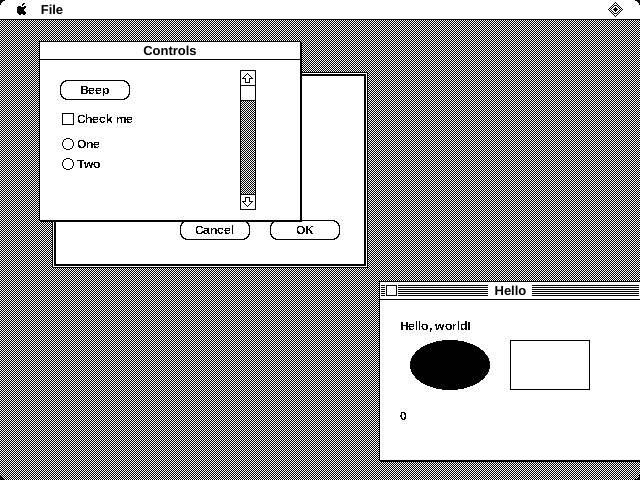
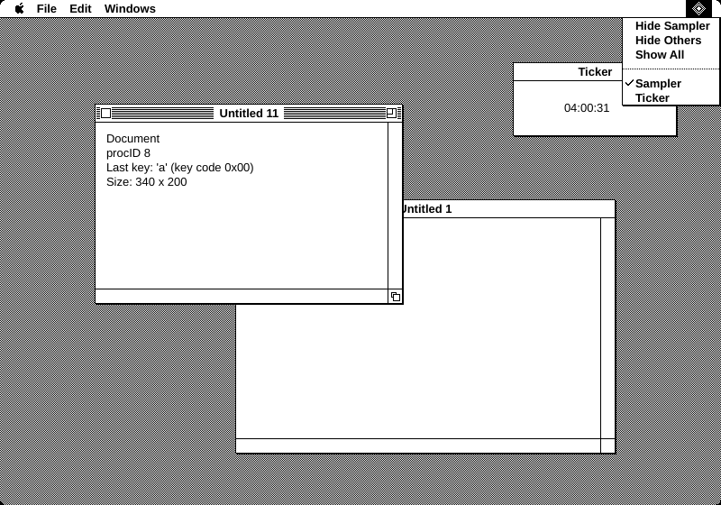
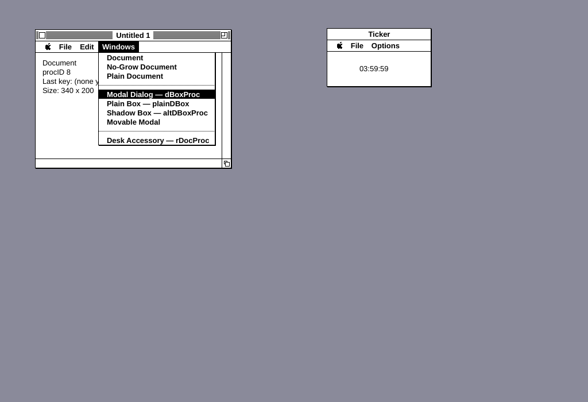
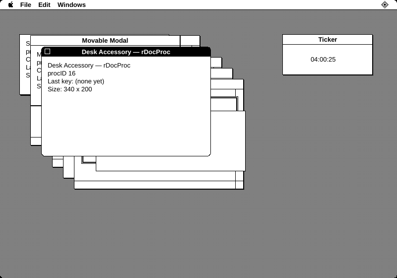

# macrt

A runtime for classic Mac OS (System 1–7) applications with a PyQt6 front end.

macrt runs an application's own 68k code on an emulated CPU, catches its
A-line traps, and answers them with a Toolbox written in Python, with Qt
widgets standing in for what QuickDraw used to draw. There is no
disassembly or translation step. The program runs as it did on a Mac, and
the Toolbox it calls into is ours. Each application's windows sit on your
desktop next to your other programs.

**Status:** real 68k applications run: TeachText, Microsoft Excel,
MacWrite, MacPaint and Word 1.0 from 1984, and games such as Creepy Castle
and Glider+ among them (see
[what's been tried](docs/running-apps.md#tried-so-far)).
- **The processor** is unicorn's 68020, in 24-bit mode, which tells programs
  it's a Mac Plus's 68000 (or, with `--model ii`, a Mac II's 68020 and
  68881) and stacks that processor's exception frames, with its trace mode
  run an instruction at a time. The Segment Loader builds each
  application's A5 world and jump table, reading segments through a patch
  the program has on `GetResource`, and a trap dispatcher
  generated from the Multiversal interfaces passes Pascal-stack and
  register calls to Python.
- **Managers** with more than 700 routines behind them:
  - Memory, Resource, Window, Menu, Event, Control, Dialog, List,
    Scrap, File and Process Managers, TextEdit and Standard File;
  - the Apple Event Manager, for the Open Application event and an
    application's events to itself;
  - QuickDraw in black and white, with real regions, pictures and icons;
  - SANE's arithmetic, conversions and elementary functions, the
    International Utilities' dates, times and string order, and the
    Script Manager for Roman text;
  - the Printing Manager, which prints to a PDF;
  - the Sound Driver's three synthesizers, the Sound Manager's sound
    channels and sampled sounds, and the Mac Plus's sound buffer, played
    through your computer's speakers;
  - MultiFinder-style switching between several applications at once.
- **Not there yet:** Color QuickDraw, and Apple events between
  applications.
  Applications that need them get as far as they can without them.

To run one, see **[docs/running-apps.md](docs/running-apps.md)**, which
covers getting a Mac application to macrt with its resource fork,
running it, and reading what it says when it stops.

```sh
python -m pip install -e .
python -m macrt App.bin                         # MacBinary, BinHex, AppleDouble…
python -m macrt "System 6.0.8.dsk" --app TeachText
python -m macrt One.bin Two.hqx                 # several, side by side
```



## The demo

With no file, macrt runs two guest applications written in Python against
the same Toolbox API, which show off the window chrome:

```sh
pip install -e '.[dev]'
python -m macrt                          # host windows, one global menu bar
python -m macrt --menubar window         # each window carries its app's menu bar
python -m macrt --host screen            # everything inside one 1-bit Mac screen
python -m macrt --host screen --size 512x342 --classic-menus
```

The demo launches two apps. **Sampler** opens every window kind from its
*Windows* menu. **Ticker** is a clock, so there's a second app to switch to.
Ctrl stands in for ⌘ (Command), Alt for Option.

| Emulated screen, global menu bar | Host windows, menu bar under each title bar |
|---|---|
|  |  |

## Opening a real application

```sh
python -m macrt App.bin                       # MacBinary
python -m macrt App.hqx --list                # BinHex; list the resources and exit
python -m macrt Disk.dsk                      # the only application on a disk image
python -m macrt Disk.dsk --app "Disk:Games:App"   # or pick one by name or Mac path
python -m macrt App.bin --view                # its menus and windows, without its code
python -m macrt App.bin --trace-traps         # log every trap it calls
python -m macrt App.bin --system System.bin   # with a real System file
unar App.sit.hqx                              # an archive: unpack it first, then
python -m macrt "App Folder/App"              # run what came out (App or App.rsrc)
```

[docs/running-apps.md](docs/running-apps.md) has the whole story: the
forms a Mac file can come in, archives and disk images, every option,
what works, and the system error IDs.

An application with no 68k code, such as a PowerPC-only one, or any
application with `--view`, gets `viewer.py`'s **ResourceViewer** in place of
its code. ResourceViewer does what the application's startup would do,
through the same Toolbox calls: `GetNewMBar` or `GetMenu` for the menu bar,
then `GetNewWindow` for the first WIND. A *Resources* menu opens the other
windows, dialogs and alerts.

## Display options

`DisplayConfig` (in `macrt/ui/display.py`) has two independent settings:

| | `menu_bar="global"` | `menu_bar="window"` |
|---|---|---|
| **`host="desktop"`** | Mac windows are frameless host windows, with one menu bar across the top of the screen | Mac windows are host windows, each with its app's menu bar under the title bar, so they blend in with host apps |
| **`host="screen"`** | One host window holds a Mac screen (desktop pattern, rounded corners) with a classic menu bar | The same screen, with the menu bars in the windows |

**Global menu bar.** The bar shows the front app's menus. Clicking another
app's window brings that app forward (MultiFinder style). It gets suspend and
resume events, the bar switches to its menus, and the click itself is not passed
on as a mouseDown. With two or more apps running, the System 7 Application menu
appears at the right end (Hide *App*, Hide Others, Show All, then the app list).
`application_menu="always"|"never"` overrides that.

**Per-window menu bar.** Every document window draws its app's bar under the
title bar. When a dialog is in front, the menus stay reachable through the app's
other windows. An app with no document windows open gets a small bar-only window
titled with its name, so its menus never disappear.

Other options: `screen_size`; `sticky_menus` (default on: a quick click on a
title leaves the menu open, Mac OS 8 style; off means strictly
press-drag-release); and `theme.RAINBOW_APPLE` for the System 7 color apple.

## How it fits together

```
guest thread (one per app)                         GUI thread
──────────────────────────                         ─────────────────────────────────
68k code on the CPU (m68k/cpu.py)
  └─ A-line trap ─▶ dispatcher (m68k/dispatch.py)
       └─ glue (m68k/glue_*.py)
            └─ Toolbox (toolbox/api.py) ─────────▶ GuiBridge.call ──▶ Display (ui/display.py)
                 WaitNextEvent ◀── EventQueue ◀──────────────────────── InputRouter (Qt events)
                 FindWindow, MenuSelect,                                     │
                 TrackGoAway, DragWindow… ◀── Future ◀── Trackers ◀──────────┘
```

* **One processor, shared.** The `Machine` (`m68k/runtime.py`) is the CPU
  and the trap stubs; every 68k application has a `Runner` on its own
  thread. As under MultiFinder, one application runs at a time. It holds
  the CPU while its code runs and gives it up in `WaitNextEvent`,
  `GetNextEvent` and the other calls that wait. Whoever takes it next gets
  its registers and its low-memory globals put back.
* **Traps.** `cpu.run()` returns at every A-line trap. The dispatcher looks
  up the trap's signature in `m68k/trapdefs.py`, which is generated from
  the Multiversal interface files: where its arguments are (Pascal stack or
  registers), its result, and its selector for dispatched traps such as
  `_Pack3` or `_OSDispatch`. Then it calls the Python routine registered
  under the trap's name with `@trap`. A known trap with nothing behind it
  is logged and skipped; one that isn't known at all stops the application
  with system error 12. `SetTrapAddress` patches work, and so does calling a
  trap through the address `GetTrapAddress` gave. A patch on an OS trap is
  entered as the Mac's dispatcher enters it, with the registers it saved on
  the stack, since some patches unwind that frame themselves. `GetTrapAddress` calls
  `_OSDispatch` unimplemented, although it works: programs that look for
  MultiFinder that way, Microsoft's among them, then make MultiFinder's
  private calls. Programs that want the Process Manager or temporary memory
  ask Gestalt.
* **Code that writes code.** The processor translates blocks of 68k code
  and runs the translation. It notices a store into a block it has
  translated, but not into the block it's running: a page is mapped to be
  run from or written to, not both, and a store into the page it's running
  from starts the processor again at the store (see `m68k/cpu.py`).
  Microsoft Word sets a trap word a few instructions ahead and then runs it.
* **Calling back.** Filter procedures, `CDEF`s, user items, action
  procedures and patched traps are 68k code that the Toolbox calls.
  `Runner.call()` runs a nested CPU loop until the routine returns.
* **Guest memory is the source of truth.** A window is a 156-byte
  `WindowRecord` in the app's heap: title, port rectangles, regions, hilite
  state, zoom states. A `MacWindowView` only draws whatever the record says.
  Poke the record the way 68k code would and the widget follows on the next
  sync.
* **The chrome is a puppet.** Qt never acts on a click by itself. Every click
  becomes a `mouseDown` event in the owning app's queue. The app calls
  `FindWindow` and then, say, `TrackGoAway`, and only then does the close box
  draw pressed. If the app never calls `DragWindow`, the window doesn't move,
  just as on a real Mac.
* **Blocking calls are trackers.** `MenuSelect`, `TrackGoAway`, `TrackBox`,
  `DragWindow` and `GrowWindow` start a tracker on the GUI thread and wait on a
  `Future` that the tracker settles from mouse events. If the button is already
  up by the time the app gets there, the tracker sees that, as `StillDown`
  would.
* **`ui/chrome.py` is the WDEF.** It is a set of pure functions for geometry,
  `wHit` codes and painting, covering document windows (with or without
  grow/zoom), `dBoxProc`, `plainDBox`, `altDBoxProc`, `movableDBoxProc` and
  `rDocProc` with its corner variations. Everything is drawn with whole-pixel
  `fillRect`, so the output is 1-bit.

```
macrt/
  memory.py  guest RAM (big-endian, 24-bit addresses) and record views
  toolbox/   api.py (the Toolbox calls), events.py, constants.py, types.py
             system.py (memory map, partitions), memmgr.py (heaps),
             lowmem.py (low-memory globals), windows.py, menus.py,
             quickdraw.py (GrafPort, QuickDraw globals, regions),
             qdraw.py (drawing), screen.py (the screen buffer), pict.py,
             icons.py, masks.py, color.py,
             controls.py, dialogs.py, lists.py (ListRec and its cells),
             resources.py (the Resource Manager),
             textedit.py, scrap.py, files.py (the File Manager),
             aliases.py (alias records),
             sane.py (SANE's arithmetic), intl.py (international formats),
             script.py (the Script Manager's character tables and breaks),
             templates.py (WIND, DLOG, ALRT, DITL, CNTL, MBAR, STR#)
  ui/        display.py, window.py, menubar.py, tracking.py, chrome.py,
             theme.py, bridge.py, keymap.py, stdfile.py (Open and Save),
             audio.py (the host's sound output), fonts/
  m68k/      cpu.py (unicorn), runtime.py (Machine, Runner, system errors),
             hardware.py (the VIA and the IWM),
             sound.py (the Sound Driver and the speaker),
             sound_manager.py (the Sound Manager's channels),
             segload.py (CODE 0, the jump table, LoadSeg), dispatch.py and
             trapdefs.py (trap signatures), glue_*.py (the trap routines:
             toolbox, os, controls, dialogs, lists, textedit, scrap,
             files, sony, aliases, stdfile, pict, icons, color, sound,
             process, aevents, ppc, sane, intl, script)
  resfork.py the resource fork format, read (every offset checked) and written
  macfile.py Mac files from the host: MacBinary, BinHex, AppleSingle/Double,
             emulator side files, HFS images through machfs, MFS images
  moof.py    Applesauce MOOF floppy images: each track's GCR bits decoded
             back to sectors
  process.py one running guest app
  viewer.py  the resource listing, and ResourceViewer, which shows an
             app's menus and windows from its resources
  demo.py    Sampler, Ticker, and the command line
```

## Guest memory

`System` (in `toolbox/system.py`) owns 8 MB of emulated RAM:

```
$000000  low-memory globals: MemTop, ScrnBase, WindowList, MenuList, CurrentA5…
$003000  system heap: the Window Manager port, GrayRgn, the System file's
         resource map and the defproc stand-ins
$100000  one partition per app, sized by its SIZE resource (else 1 MB)
top      the 1-bit screen buffer
```

A 512×342 screen is where a Mac 512K has it instead, at `$7A700` with the
alternate buffer at `$72700` below it. The system heap ends below both,
and the partitions take the rest of RAM above them. Games from 1984 write
there without asking `ScrnBase`.

Each partition is laid out like a classic Mac application space: heap at the
bottom, stack below the A5 world, A5 world at the top. The QuickDraw globals
(thePort, the patterns, the arrow cursor, screenBits) sit just below A5, and
0(A5) points to thePort, which is where `InitGraf` leaves it.

* **Memory Manager** (`memmgr.py`): pointers and handles with the 24-bit block
  header (tag byte, physical size, relative handle or zone pointer) and master
  pointers with their flag byte (locked, purgeable, resource). Code that looks
  at a header finds what it expects there. Blocks never move to compact the
  heap. A handle moves only when `SetHandleSize` can't grow it in place, and
  never while it is locked. When an allocation doesn't fit, the application
  heap grows toward `ApplLimit`, all the way when even that isn't enough:
  programs written before `MaxApplZone` ask for more than there is to get
  the whole heap, and MacWrite counts what's free by walking the block
  headers. Failing that, unlocked purgeable blocks are purged, lowest
  address first, until it does. A purged handle stays valid with a NIL
  master pointer, as `EmptyHandle` leaves it.
* **Per-app globals** (`lowmem.py`): under MultiFinder some low-memory globals
  belong to the running app (`WindowList`, `MenuList`, `CurrentA5`, `ApplZone`…).
  Each app keeps its copy in a `World`, which is swapped in while that app has
  the CPU. The Toolbox always goes through the `World`, so it gets the right
  copy either way.
* **Records** (`windows.py`, `menus.py`, `quickdraw.py`): `GrafPort` (108 bytes),
  `WindowRecord` (156 bytes, chained through `nextWindow` from the app's
  `WindowList` global), `MenuInfo` (a handle: ID, enable flags, then menuData
  with the title and items), and the `MenuList` menu bar handle, all laid out
  as in Inside Macintosh. The Python classes are views over the bytes. There is
  one canonical view per port address, so a WindowPtr that comes back from guest
  code is the same object the UI knows.
* **QuickDraw** (`qdraw.py`) draws into a QImage for each window (its
  `Backing`, which the window shows), or, for any other port, into its
  portBits: a 1-bit bitmap in guest memory, so offscreen drawing and
  `CopyBits` work as on a Mac. Regions are real QuickDraw regions, read from
  and written back to their data in guest memory. Text moves the pen a whole
  number of pixels for each character, as on a Mac, so text that a word
  processor measures a character at a time lands where it draws it.
* **The screen buffer** (`screen.py`) mirrors the windows. What QuickDraw
  draws in a window is written to the buffer where the window is seen,
  and what a program writes in the buffer itself is drawn in the window
  it lands on, the next time macrt looks: at a trap, or from the CPU's
  clock once a tick while the program calls none.



## Resources

`toolbox/resources.py` is the Resource Manager. As on a Mac, resource maps
live in the heap in their on-disk format, so 68k code that walks one finds
what it expects, and resources are read in through `_ResourceStub`, so an
application's patch on it, given a map's handle in A4 and an entry in A2,
can read them in its own way.

* **Files.** `macfile.load_file` reads a Mac file in whatever form the host
  keeps it: MacBinary I/II/III, BinHex 4.0, AppleSingle, AppleDouble
  (`._app`, `.AppleDouble/app`, or `app.rsrc` as The Unarchiver writes it),
  Basilisk II's `.rsrc/` and `.finf/`, Executor's `%app`, a bare `app.rsrc`,
  or macOS's `..namedfork/rsrc`. `open_application` is what the command line
  uses: it also opens disk images and refuses StuffIt and zip archives with a
  hint. `load_volume` opens HFS
  disk images, raw, DiskCopy 4.2 or behind an Apple partition map, through
  machfs, and reads MFS (400K) disks itself into the same form: their one
  flat directory, each fork followed through the block map. A MOOF image
  of a floppy's tracks is decoded to its sectors first (`macrt.moof`): the
  GCR bytes found in each track's bits, and each sector's three bytes to
  four of them, unmixed from the checksum that runs through them. The
  volume keeps its disk's sectors and their tags as `.disk`, for the
  floppy disk driver (`glue_sony`), and a MOOF image's tracks with them. A `Folder`
  finds files by Mac name, case-insensitively, and
  `OpenResFile` looks names up in the folder the app came from.
* **The chain.** Opening a file copies its map into a handle, fills in
  `nextMap` and the file reference number, and puts it at the top of the
  app's chain (`TopMapHndl`, `CurMap`). Every chain ends at the System file's
  map in the system heap (`SysMapHndl`, `SysMap` = 2). If no System file is
  given, an empty one is made. Either way the WDEF, MDEF, CDEF, LDEF and MBDF
  stand-ins are resources in it, so `GetResource('WDEF', 0)` works and a
  window's `windowDefProc` is a real resource handle. So are the standard
  resources in `sysres.py` that the file lacks: `PACK` 0 to 15 (each the
  package's trap with auto-pop, so calling into the package is the same
  as calling the trap), the alert icons `ICON` 0 to 2 and the cursors
  `CURS` 1 to 4.
* **Loading.** The entry in the map holds the resource's handle, so asking
  twice gives the same handle. Attributes set the master pointer flags:
  locked, purgeable, `resSysHeap` (loaded into the system heap) and
  `resPreload` (loaded at open). A purged resource is read again into the same
  handle. System 7 compressed resources are expanded through rsrcfork; one
  that won't expand gives `CantDecompress`.
  `SetResLoad(false)`, `Get1…` and `UseResFile` behave as documented.
* **Changes.** `AddResource`, `ChangedResource`, `RemoveResource`,
  `SetResInfo` and `SetResAttrs` work on the map in memory. `UpdateResFile`
  and `CloseResFile` write the fork back into the `MacFile`. Nothing is
  saved to the host file yet.
* **The application.** A launch opens the app's resource fork as its current
  file (`CurApRefNum`) and sizes its partition from its SIZE resource.
  Quitting closes every file the app opened.

`toolbox/templates.py` parses WIND, DLOG, ALRT (with its four stages), DITL,
CNTL, MBAR and STR#, and applies System 7 positioning words such as
`centerMainScreen` and `alertPositionMainScreen`. On top of these:
`GetNewWindow`, `GetMenu` (the MENU resource *is* the MenuInfo; its MDEF ID
becomes the MDEF's handle), `GetNewMBar`, `SetMenuBar`, `GetMenuBar`,
`GetString` and `GetIndString`. The Dialog and Control Managers build their
dialogs, alerts and controls from DLOG, ALRT, DITL and CNTL.

```python
from macrt.macfile import load_file

app = load_file("Hello.bin")            # or ._Hello, Hello.rsrc, …
display.launch(app.name, guest, app=app)
# guest(tb): tb.SetMenuBar(tb.GetNewMBar(128)); w = tb.GetNewWindow(128) …
```

## Fonts

The chrome looks right with Chicago (system font) and Geneva (application
font). These aren't bundled. Put `.ttf`/`.otf` files in `macrt/ui/fonts/` and
they load at startup. *ChicagoFLF* is a freely licensed Chicago clone. With a
Mac font present, text is drawn without antialiasing for the crisp 1-bit look.
Without one, macrt falls back to Helvetica at 13px with antialiasing on, because
outline fonts look broken without it. `theme.TEXT_ANTIALIAS = True/False`
forces either.

Those host fonts stand in for the standard families (Chicago, Geneva, New
York, Monaco and the rest). A family an application brings with it, as a
`FONT`, or as an `NFNT` its `FOND` lists, is drawn from the font's own
bitmap. That matters because such fonts often hold pictures rather than
letters: MacPaint's tool palette is one, and games keep sprites and score
digits in them. A size the application doesn't have is scaled from the
nearest one it does. A standard family is drawn from a strike too when the
application carries its own of the size, as on a Mac, where the
application's file is looked in before the System's: Balance of Power
traces its New York 36 title letter by letter and needs them where they
were. Text in such a font is measured with the font's own widths too,
by `StringWidth`, `MeasureText`, TextEdit and `TETextBox` alike, so lines
break where the application expects. Bold, italic, underline, outline and
shadow are drawn as QuickDraw draws them. What a Mac font has no width for,
such as NUL and return in Chicago, Geneva and Monaco, draws nothing, where
a host font would draw a box.

## Host platform notes

* **Wayland** doesn't let apps place their own windows. With `host="desktop"`
  window drags go through the compositor (`startSystemMove`), but windows can't
  be placed exactly. Use `QT_QPA_PLATFORM=xcb` (XWayland) or `host="screen"`.
* **macOS** already has a global menu bar at the top of the screen, so use
  `--menubar window` or `--host screen` there.
* With `host="desktop"`, the shaped windows and their 1-pixel shadows rely on
  `setMask`, which works without a compositor.

## Tests

```sh
pytest                      # runs offscreen, in about half a minute
```

`tests/test_memory.py` and `tests/test_records.py` check RAM, the heap, the
switched globals and every record byte for byte against Inside Macintosh.
`tests/test_qdraw.py` checks QuickDraw's drawing bit by bit in 1-bit bitmaps
and its regions against QuickDraw's own region format, and
`tests/test_pict.py`, `tests/test_icons.py` and `tests/test_color.py` check
pictures, icons and the colour calls on a 1-bit screen.

`tests/test_m68k_apps.py`, `tests/test_controls.py`, `tests/test_dialogs.py`,
`tests/test_lists.py` and `tests/test_process_mgr.py` run the 68k
applications in `tests/apps` on the emulated CPU and drive them with
synthetic clicks and keys. These are small programs in assembly, one per
part of the Toolbox:

- **Hello:** windows, menus and drawing.
- **Controls:** buttons, check boxes, radio buttons and a scroll bar.
- **Dialogs:** a modal dialog with an edit field, and an alert.
- **Edit:** a TextEdit window, with cut, copy and paste through the scrap.
- **Lists:** a List Manager list with a scroll bar, clicked, extended and
  scrolled.
- **Launcher:** `_Launch`.
- **Menus:** the application's own menu bar definition procedure.
- **VBL:** a VBL task, run every other tick, during a `Delay` too, until
  it's removed.
- **Sounds:** the Sound Driver's square-wave, four-tone and free-form
  sounds, then samples written straight into the sound buffer.
- **Vectors:** its own handlers in the exception vectors: for `TRAP #1`,
  dividing by zero, `CHK`, and the VIA's interrupts, going on to the ROM's.
- **AEvents:** the Apple Event Manager and a PPC port: the Open
  Application event, and an event it sends itself with a list in it.

`python tests/apps/build.py` rebuilds them with binutils for m68k. The
built `.bin` files are checked in, so the tests don't need the assembler.

`tests/test_files.py` reads forks, MacBinary, BinHex (including a damaged
one), AppleSingle/Double, the emulators' side files and The Unarchiver's,
HFS images (made with machfs) and MFS ones (made byte by byte, with
forks scattered across the disk), MOOF images of them (GCR-encoded track
by track in `tests/builders.py`, with sectors that can't be read), and
checks how the command line picks
applications on disk images and refuses archives.
`tests/test_filemgr.py` checks the File Manager on the boot volume, host
folders and disk images, from Python and from 68k code, the floppy disk
driver, a program's own `RdData` and the ROM's, and drives the Open and Save dialogs. `tests/test_textedit.py` checks TextEdit's records
and drawing, and `tests/test_scrap.py` the scrap and the host clipboard.
`tests/test_viewer.py` checks the resource listing, the command line's
errors, and ResourceViewer in a running display.
`tests/test_resources.py` checks purging, the resource chain in guest memory,
loading, purge and reload, opening and closing files, writing forks back, the
templates, and an app whose menus and windows come from its resources, driven
through a running display.

`tests/test_sane.py` checks SANE against the Apple Numerics Manual's tables
and the IEEE special cases (NaNs, infinities, denormals, signed zeros) in
every rounding direction and precision, cross-checks double arithmetic
against the host's, and calls the packages from 68k code for their
condition codes and halts. `tests/test_intl.py` checks the US international
resources, dates, times and string order. `tests/test_script.py` checks the
Script Manager's character types, case and accents, words, line breaks,
truncation and justified measuring, and its dispatcher's selectors.
`tests/test_fonts.py` checks the standard font families and font menus.
`tests/test_bitfonts.py` checks an application's own bitmap fonts and the
System's pattern list.
`tests/test_aevents.py` checks Apple event data and the Apple Event
Manager's own coercions.
`tests/test_screen.py` checks the screen buffer: QuickDraw's drawing
written through to it, a program's own writes shown in its windows, and
the desk. `tests/test_hardware.py` checks the VIA and the IWM, the
512×342 screen where a Mac 512K has it, the ROM and the exception vectors
in it, and the Event Manager's low-memory record of the mouse and
keyboard.
`tests/test_cpu.py` checks the processor's slices, interrupts and speed
limit, where an exception from a divide, `CHK` or `TRAPV` returns to, and
trace mode.

`tests/test_display.py` drives the real input path with synthetic Qt mouse and
key events, in both menu-bar modes. It covers:

- the close box (including releasing outside it), dragging, growing, and
  zooming in and out;
- selecting a back window;
- press-drag-release menus, sticky menus, disabled items and ⌘-keys;
- switching apps, the Application menu (switch, Hide Others), per-window
  bars and the bar-only window;
- quitting, and a window that follows a poked record.

## Next

1. Color QuickDraw.
2. Suspend and resume when a host window gains or loses focus, so the
   clipboard follows without an extra click.
3. More real applications, fixing whatever each one reaches first (see
   [the ones tried so far](docs/running-apps.md#tried-so-far)).
